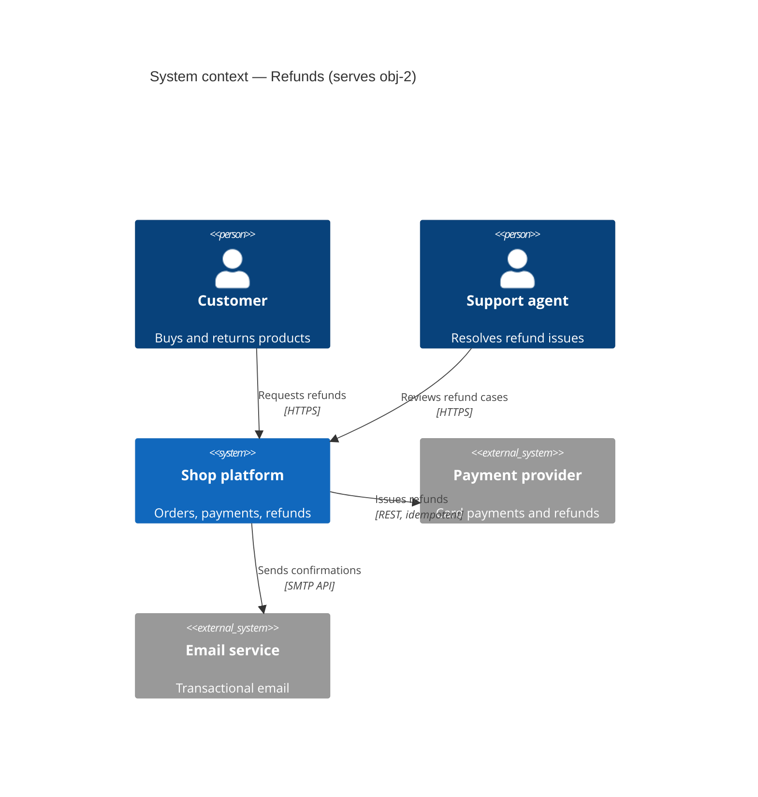
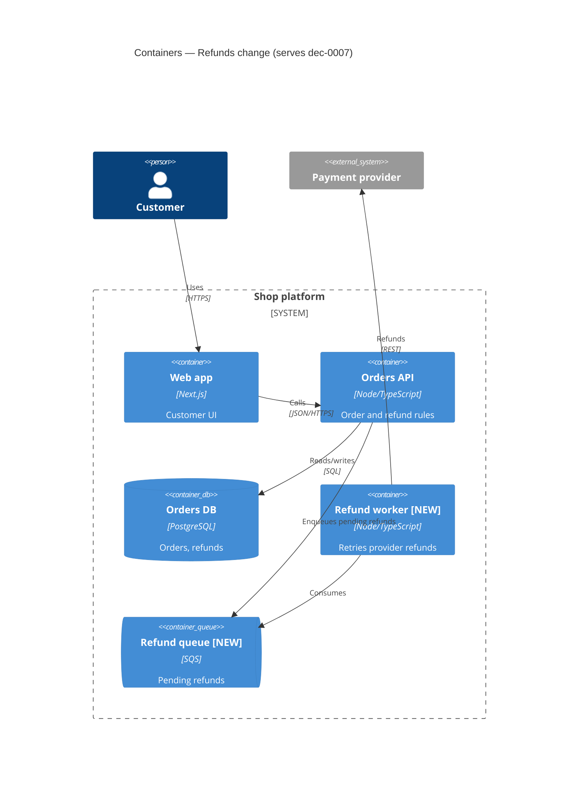
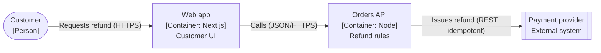

# C4 standard

C4 (Simon Brown) describes software architecture as a set of zoom levels. Each view answers one audience's question. Produce only the levels the board needs — usually Context and Container; Component only for the containers under change; Code almost never.

## Levels

| Level | Shows | Audience | Required when |
| --- | --- | --- | --- |
| 1. System context | The system as one box, its users, and the external systems it talks to | Everyone, including non-technical | Any new system, new external dependency, or new user type |
| 2. Container | Deployable/runnable units (web app, API, DB, queue, function) and how they communicate | Engineers, ops, security | Any change that adds, splits, merges, or rewires containers |
| 3. Component | Major building blocks inside one container and their responsibilities | Engineers on that container | A container's internal structure is under decision |
| Deployment | Containers mapped onto infrastructure nodes, regions, environments | Ops, SRE, security | Hosting, scaling, failover, or region decisions |
| Dynamic | Numbered interactions for one scenario across containers | Engineers, reviewers | A runtime flow is contested (or use a UML sequence) |

## Notation rules

- Every element has a **name, type, technology (for containers/components), and a one-line responsibility**.
- Every relationship has a **label describing intent and protocol** ("Reads orders from [SQL]", "Publishes OrderRefunded to [Kafka]"), with a direction.
- Use a key/legend; colors are meaningful (e.g. new vs existing vs external) or absent.
- Mark what changes: `[NEW]`, `[CHANGED]`, `[REMOVED]` in names or via style, so reviewers see the delta.
- Keep each view under ~20 elements; split by scope rather than shrinking text.
- Names are consistent with UML sequence participants, Gherkin domain terms, and ADR text.

## Mermaid templates

Mermaid has experimental C4 support (`C4Context`, `C4Container`, `C4Component`, `C4Deployment`). If rendering is unreliable in the target viewer, use a `flowchart` with C4-style labels.

Flowchart fallback:

## Verifier checklist

- [ ] Title names the view level, scope, and the objective/decision it serves.
- [ ] Every element has name, type, technology (L2/L3), and responsibility.
- [ ] Every relationship is directional, labeled with intent, and with protocol where relevant.
- [ ] Changed elements are marked; external systems are visually distinct.
- [ ] Trust boundaries are visible where the security reviewer needs them (system boundary, network zones).
- [ ] Names match ADRs, sequence diagrams, and the glossary.
- [ ] No more than ~20 elements; no mixing of levels in one view.
- [ ] Deployment view (if present) shows regions/AZs, environments, and the failover path the board discussed.
