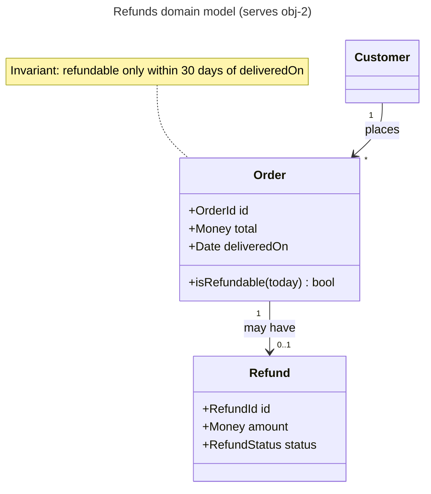
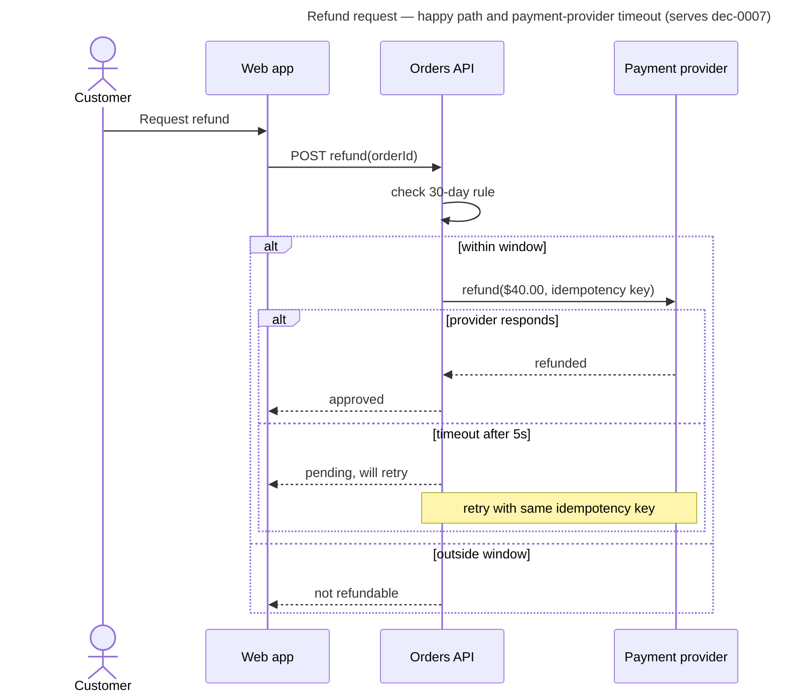
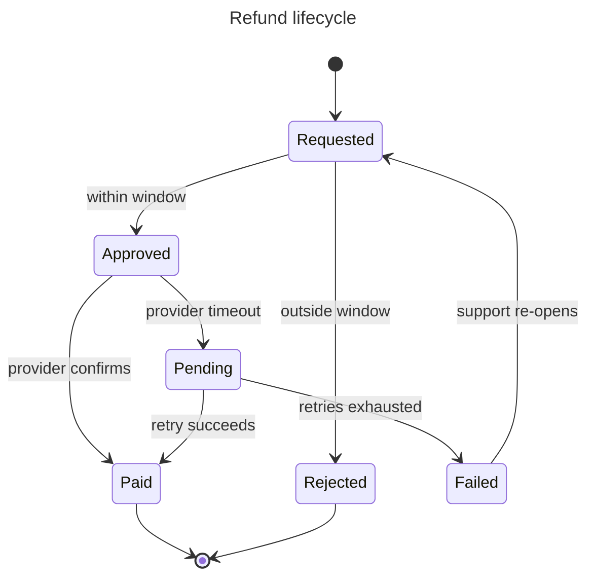

# UML standard

UML is a toolbox, not a deliverable. Use the one or two diagram types that answer a live board question, at the level of detail that question needs. Draw in Mermaid unless the repository already uses PlantUML.

## Choosing a diagram

| Question on the board | Diagram | Owner (default) |
| --- | --- | --- |
| What are the domain concepts, their attributes, and relationships? | Class (domain model) | `domain-modeler` |
| Who calls whom, in what order, and what happens on failure? | Sequence | `api-integration-designer` |
| What states can this thing be in, and what moves it between them? | State machine | `domain-modeler`, `ux-flow-designer` |
| How does a workflow branch, loop, and run in parallel? | Activity | `business-process-analyst`, `ux-flow-designer` |
| Which actors pursue which goals with the system? | Use case | `requirements-analyst` |
| How are deployable parts wired? | Prefer C4 deployment over UML deployment | `sre-reliability` |

## Class diagram (domain model)

Conceptual, not code: names come from the ubiquitous language; include only attributes and operations that carry business rules. Show multiplicities and aggregate boundaries.

Checklist: names match the glossary and Gherkin; every association has multiplicity; invariants are noted next to the class that enforces them; no persistence or framework types (`DTO`, `Repository`, `id: int8`) unless the diagram is explicitly a design-level class diagram.

## Sequence diagram

Show one scenario per diagram, including the failure branch that matters. Name participants by role or container (consistent with C4), not by class.

Checklist: one scenario per diagram; failure/timeout branch included where the board flagged it; idempotency, retries, and timeouts explicit for remote calls; participants match C4 container names; messages are business-meaningful.

## State machine

Use when the board has lifecycle rules ("can a cancelled order be refunded?").

Checklist: every state reachable and every non-final state has an exit; guards written as business conditions; terminal states explicit; each transition that users can observe has a Gherkin scenario; illegal transitions listed if the board asked about them.

## Activity diagram

Use Mermaid `flowchart` for activity flows when swimlanes are not essential; use BPMN (see other-formats.md) when handoffs between people or departments are the point.

Checklist: one start, explicit ends; decisions labeled with conditions on every branch; parallel work shown as fork/join; loops have an exit condition.

## Use case diagram

Mermaid has no native use-case diagram; use a flowchart with actors as stadium shapes and use cases as rounded boxes, or a use-case table:

| Actor | Goal (use case) | Trigger | Main success outcome | Key extensions |
| --- | --- | --- | --- | --- |

Checklist: goals are user goals, not UI steps; each use case links to a Gherkin feature or is marked out of scope.

## Common mistakes

- Reverse-engineering every class from code into one giant diagram — answer a question instead.
- Mixing conceptual and implementation levels in one view.
- Sequence diagrams with only the happy path when the board's risk is the failure path.
- State diagrams missing the "stuck" states (pending, failed, expired).
